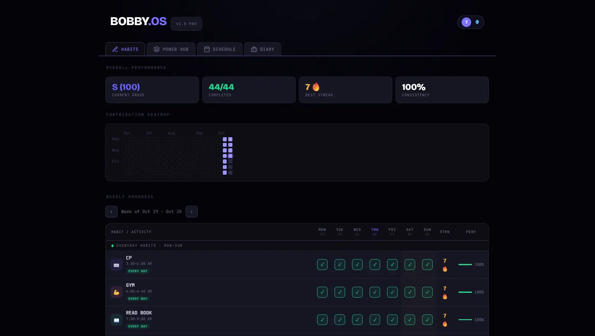

# 🌌 BOBBY.OS | The Elite Developer & Student Productivity Ecosystem

[](https://github.com/vijaypagolu2007/BOBBY.OS)
[](https://vitejs.dev/)
[](https://firebase.google.com/)
[](https://capacitorjs.com/)

> **"Elite Productivity through Aesthetic Precision."**  
> BOBBY.OS is a premium personal dashboard for developers, students and competitive programmers. It turns your daily habits, schedule, study routine and Codeforces stats into one fast, offline-first dashboard, with a Gemini-powered advisor on top.

**Live app:** [bobbyos-e7ba5.web.app](https://bobbyos-e7ba5.web.app) · Want to help? See the [contributor guide](CONTRIBUTING.md).



---

## 🚀 Features

### ✅ Habits

- **Weekly habit grid:** habits come from your schedule; tick them off day by day and see per-habit streaks and completion %.
- **Performance overview:** letter grade, completed count, best streak and consistency at a glance.
- **Contribution heatmap:** GitHub-style view of your recent activity.

### 🗓️ Schedule

- **Day-by-day timetable** (Mon to Sun) with everyday, college and custom blocks.
- **Smart Add:** type `Gym 6-7 AM` and it becomes a schedule block.

### ⚡ Power Hub

- **Zen Pomodoro:** 25, 45, 60 or 90 minute sessions, optionally linked to a habit.
- **The Big 3:** your three critical targets for the day.
- **Sleep tracker:** log actual sleep against your target and see recovery efficiency.
- **Codeforces command center:** live rating, rank and max rating for your handle.
- **Gemini Intelligence:** one tap on **Optimize Schedule** sends your schedule and progress to Gemini for a short, practical suggestion.

### 📔 Diary

- Daily wins, challenges, lessons and tomorrow's top priority, with mood and energy level.

### 🎨 Personalization

- **Themes:** Obsidian Void (purple), Crimson Matrix (red), Emerald Green and Matrix Monochrome.
- **UI density:** Standard or Compact layout.
- **Reminders:** browser and Android notifications for your daily check-in.

---

## 🛠️ Architecture

| Layer       | What it uses                                                                     |
| ----------- | -------------------------------------------------------------------------------- |
| Frontend    | Vanilla JS modules + Vite, Chart.js (bundled, no CDN)                            |
| Auth & data | Firebase Auth (email + Google) and Cloud Firestore                               |
| AI          | Firebase AI Logic (Gemini Developer API), protected by App Check (reCAPTCHA)     |
| Offline     | PWA service worker (vite-plugin-pwa, ~1.2 MB precache) + Firestore offline queue |
| Android     | Capacitor 8 WebView wrapper                                                      |
| Hosting     | Firebase Hosting                                                                 |

Everything runs on Firebase's **free Spark plan**. There is no backend server and no Cloud Functions.

Data uses a three-tier offline-first model:

1. **Memory store (`S`):** global in-memory state for instant reads.
2. **LocalStorage cache:** per-user copy so the app works fully offline.
3. **Cloud Firestore:** syncs across laptop and phone when you're online.

### Code organization

Feature entry points stay small and delegate to focused modules. For example, `js/power.js` only initializes the Power Hub; its Pomodoro timer, targets, sleep tracker, AI insights and Codeforces integration live in `js/features/power/`. Share persistence through `js/db.js`, and keep DOM wiring close to the feature.

---

## ⚙️ Setup

### Prerequisites

- [Node.js](https://nodejs.org/) **20.19+ or 22.12+** (required by Vite 8)
- npm 10+
- For Android only: the Android SDK + platform tools (`adb`) and **JDK 21**. Newer JDKs (for example Java 25) don't work with the bundled Gradle 8.14.

### 1. Install

```bash
git clone https://github.com/vijaypagolu2007/BOBBY.OS.git
cd BOBBY.OS
npm install
```

### 2. Configure Firebase

```bash
cp .env.example .env
```

Fill in `.env`:

```ini
VITE_FIREBASE_API_KEY=your_api_key
VITE_FIREBASE_AUTH_DOMAIN=your_auth_domain
VITE_FIREBASE_PROJECT_ID=your_project_id
VITE_FIREBASE_STORAGE_BUCKET=your_storage_bucket
VITE_FIREBASE_MESSAGING_SENDER_ID=your_messaging_sender_id
VITE_FIREBASE_APP_ID=your_app_id

# Gemini advisor (optional)
VITE_RECAPTCHA_SITE_KEY=your_recaptcha_site_key
VITE_APPCHECK_DEBUG_TOKEN=          # local dev only
```

To enable the Gemini advisor:

1. Firebase console > **AI Logic** > Get started > **Gemini Developer API**.
2. Create a score-based reCAPTCHA key at [google.com/recaptcha/admin](https://www.google.com/recaptcha/admin) and add your domains (`localhost`, `bobbyos-e7ba5.web.app`).
3. Firebase console > **App Check** > register the web app with that key, and paste the site key into `VITE_RECAPTCHA_SITE_KEY`.
4. For local dev, generate a debug token under App Check > Apps > ⋮ > **Manage debug tokens** and put it in `VITE_APPCHECK_DEBUG_TOKEN`.

### 3. Run locally

```bash
npm run dev
```

Open [http://localhost:3000](http://localhost:3000).

---

## 🧪 Tests & Code Quality

```bash
npm run check       # ESLint + Prettier check (same as CI)
npm run test:unit   # Jest unit tests
npm run test:e2e    # Playwright end-to-end tests
npm test            # both test suites

npm run lint:fix    # auto-fix lint issues
npm run format      # apply Prettier formatting
```

---

## 📱 Android (Capacitor)

### 1. Point Java at JDK 21 (Windows)

Run this in the same terminal before building:

```bat
set "JAVA_HOME=C:\Program Files\Eclipse Adoptium\jdk-21.0.12.101-hotspot"
set "PATH=%JAVA_HOME%\bin;%PATH%"
java -version
```

Adjust the path to wherever your JDK 21 is installed.

### 2. App Check debug token

App Check rejects reCAPTCHA tokens from the Android WebView, and Play Integrity needs a paid Play Console account, so Android builds use a registered debug token instead:

1. Firebase console > App Check > Apps > your web app > ⋮ > **Manage debug tokens** > Add debug token. Copy the generated token.
2. Save it in `.env.android` (gitignored) next to `.env`. On Windows, note the `>` right after the token:
   ```bat
   echo VITE_APPCHECK_ANDROID_TOKEN=YOUR-TOKEN-HERE> .env.android
   type .env.android
   ```

Anyone with the APK could extract the token, so keep the APK to yourself and delete the token in the console if it leaks. With no billing on the project, the worst case is someone using up the free Gemini quota.

### 3. Build and install on your phone

Connect your phone by USB with USB debugging on, then:

```bash
npm run android
```

This runs `vite build --mode android` (which reads `.env.android` on top of `.env`), `cap sync android` and `cap run android`. Use this instead of `npm run build`, which never includes the Android token.

**If the device isn't detected** (or you see `Invalid target ID`), install manually:

```bash
npm run build:android
npx cap sync android
cd android && gradlew assembleDebug && cd ..
adb install -r android/app/build/outputs/apk/debug/app-debug.apk
adb shell monkey -p com.bobbyos.app -c android.intent.category.LAUNCHER 1
```

On macOS/Linux use `./gradlew` instead of `gradlew`.

### Live reload (optional)

1. Find your laptop's local IP (for example `192.168.1.5`).
2. In `capacitor.config.json`, temporarily add `url` and `cleartext` to the `server` block (don't commit this):
   ```json
   "server": {
     "url": "http://192.168.1.5:3000",
     "cleartext": true,
     "androidScheme": "https",
     "hostname": "app.bobbyos-e7ba5.web.app"
   }
   ```
3. Run `npm run dev`, which already listens on your network.

---

## 🚀 Deploy (Firebase Hosting)

```bash
npm run build
npx firebase-tools deploy --only hosting,firestore:rules --project bobbyos-e7ba5
```

Firestore security rules live in [`firestore.rules`](firestore.rules): each signed-in user can read and write only their own `users/{uid}` document, and everything else is denied.

Once deployed, the app can be installed from the browser (**Install app** / **Add to Home Screen**) and keeps working offline.

---

_Developed with precision for the next generation of power users._  
_© 2026 BOBBY.OS_
